<!--
  Slides are separated by a line containing only three dashes (vertical: two).
  Pick a layout with a ".slide:" comment, e.g. the one below (see ibm/README.md).
  Raw HTML works anywhere; leave a blank line inside a div so the Markdown
  in it is still parsed. A line starting "Note:" begins speaker notes.
-->

<!-- .slide: class="cover" -->

# The Elements of Context Engineering: The Foundations of AI-Native Teams

Olivia Buzek IBM

JPMorgan Chase PowerUp Conference 2026

---

<!-- .slide: class="media-half bio" -->

## Olivia Buzek

Senior Staff AI Engineer, Lead Developer Advocate for AI IBM

* 🦜 ~18 years working on AI and machine learning
* 🗣️ Computational linguist by training
* ❤️ OSS and inner source dev advocate for 7 years
* 🧱 Builder of AI games and applications
* 🚀 Mission: Make AI accessible for humans

---

<!-- .slide: class="section-divider" -->

## The Year In AI

Note:
1. The hype: not as history, but as context for why we care so much about being "AI native." Ending on a layout for the talk, promising to cut through the hype to the actual reality of what's possible.

---

<!-- .slide: class="chart light" style="--ibm-bg: #fefefe" -->

## Developers: JetBrains

90% of developers use AI coding agents at work at least weekly. 68% use them daily.

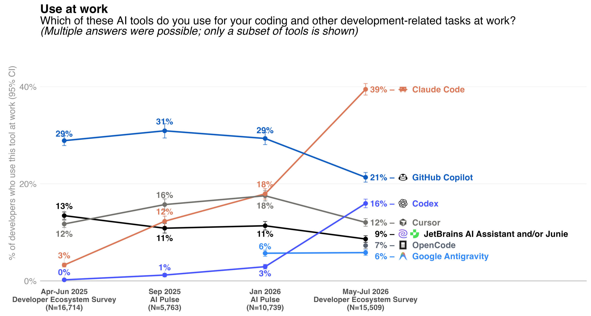

JetBrains Research, "AI Coding Agents: Adoption Trends," Aug 18, 2026

Note:
JetBrains shows number go up

* shared context is critical for organizations today

*  lots has changed since LLMs

* something like 90-95% o developers use AI coding agents already: either above board or below board

[ref] https://blog.jetbrains.com/research/2026/08/ai-coding-agent-adoption-2026/ (verified on the page): "As of May–July 2026, 90% of professional developers were using AI coding agents at work at least weekly in one form or another (local agents or remote cloud agents), with 68% using them daily." That 90% is a single wave (no general-agent trend). The chart is per tool: "Which of these AI tools do you use for your coding and other development-related tasks at work?" Claude Code 3% → 12% → 18% → 39%; Copilot 29% → 21%; Codex 0% → 16%. Developer Ecosystem Survey 2026 (N=15,509), reweighted; vendor survey.

[ref] Not the same as DORA's 90%: DORA 2025, "90% of survey respondents report using AI at work" (nearly 5,000 technology professionals, AI in general, 2025).

---

<!-- .slide: class="chart light" style="--ibm-bg: #f1f8ef" -->

## Uneven Spending

Daily AI use in the technology industry has grown every quarter.

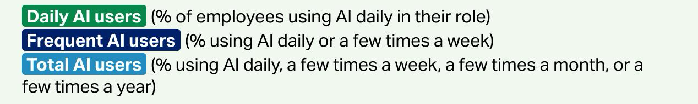
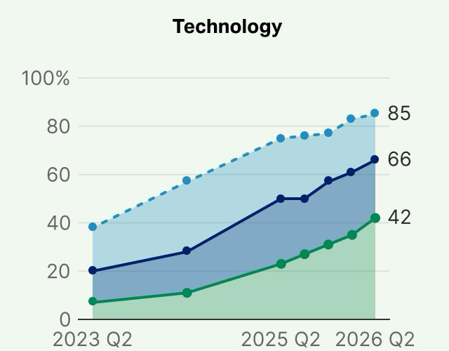

Gallup, "Trends in Workplace AI Use, by Industry," Q2 2023 – Q2 2026

Note:
Gallup shows number go up

[ref] https://www.gallup.com/699797/indicator-artificial-intelligence.aspx · data: AI-Use-Trends-by-Industry.xlsx · by industry, not occupation: everyone employed in tech, not just engineers · generic AI, not agents.

---

<!-- .slide: class="chart" -->

## Uneven Spending

Most engineers: $50 a month on AI.  
10% of engineers spend **13x that amount**

Jellyfish, Q1 2026: 12,000 developers at 200 companies

Note:
yet people numbers say adoption is uneven

[ref] Jellyfish, "Is tokenmaxxing cost effective?" (Apr 15, 2026; Q1 2026 data): median $52.38/month, P75 $226.58, P90 $691.14 (≈13×). Figure heights in the diagram are proportional to those numbers. https://jellyfish.co/blog/is-tokenmaxxing-cost-effective-new-data-from-jellyfish-explains/

[ref] Jellyfish H1 2026: "more than half of users still spent under $100 a month, yet the mean ($248) ran 3.5x the median and the 99th percentile ($2,452) ran 35x it." https://jellyfish.co/state-of-ai-software-engineering/

[ref] Arcolano quote: https://workos.com/blog/nicholas-arcolano-jellyfish-token-maxing-diminishing-returns · DX Q2 2026: "Gains are concentrated, and the gap is widening." https://getdx.com/news/dx-releases-q2-2026-state-of-ai-impact-in-engineering-report/ · DORA 2025 "amplifier": https://dora.dev/research/2025/dora-report/

[ref] Spend figures are Jellyfish estimates at API list prices (vendor telemetry), company-paid.

* DORA state of the industry report basically shows that a small percentage of every team is actually being able to take advantage of AI to deliver actual speedups for teams

* maybe 2/7 of the people: they spend $1,000s a month on their AI, and they get a lot done

* then there’s the rest of the team, who aren’t able to effectively take advantage of AI to make meaningful progress

* so they’re maybe getting some individual speedups at their tasks, but maybe not the kinds of speedups that make a meaningful difference to the business

---

<!-- .slide: class="chart light" style="--ibm-bg: #e7e7db" -->

## Anthropic's AI native dream

"In May 2026, Anthropic averaged around 2,500 code changes merged per day; as of September, we merged over 30,000 per day."

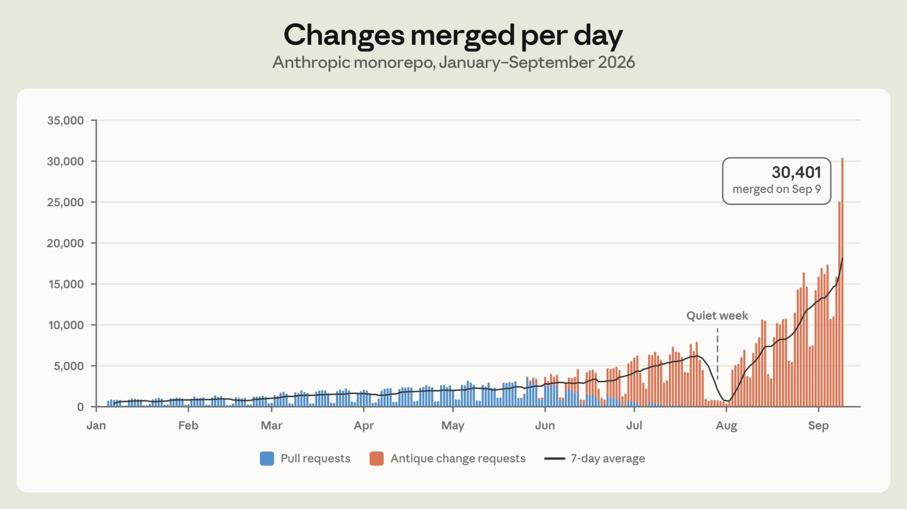

Anthropic Engineering, "Redesigning source control at Anthropic," Oct 13, 2026

Note:
meanwhile, Anthropic says they're living the AI-native dream (show chart that's been circulating)

* but the model story is only a small part of the overall AI puzzle. if you’ve been following the discourse, you’ve probably seen this chart going around (insert: Anthropic graph showing that they’re now merging 30,000 PRs a day, or something insane like that). in this talk, I want to dissect a little bit: what did it take to get them there? is that practical for others to adopt? and what are the elements of AI coding that we can take home as lessons in enterprise settings, where we need to take an enormous amount of care with the software we deliver?

given all of this, what do we conclude? do we believe that "everyone else is AI native"? if they are: how? if not: why not?

[ref] https://www.anthropic.com/engineering/redesigning-source-control · Jan (~1,000/day) and the Sep 9 peak (30,401) are from Simon Willison: https://simonwillison.net/2026/Oct/13/redesigning-source-control-at-anthropic/ · chart image is Anthropic's own, from the post (blue = pull requests, orange = "Antique" change requests).

---

<!-- .slide: class="contents" -->

## Today

<ol class="plain">
<li>01 The Year in AI</li>
<li>02 Understanding how agents "think"</li>
<li>03 How do you collaborate with "agents" you can't trust?</li>
<li>04 A glimpse of the future</li>
<li>05 The reality of agent factories</li>
<li>06 The missing piece: shared context</li>
<li>07 How are they doing it?</li>
<li>08 So now you know</li>
</ol>

Note:
1. The hype: not as history, but as context for why we care so much about being "AI native." Ending on a layout for the talk, promising to cut through the hype to the actual reality of what's possible.

---

<!-- .slide: class="section-divider" -->

## Understanding how agents "think"

Note:
2. The side quest: The maps and AI cognition. Heavily conceptual, _but_ it really doesn't have to go too far. Just enough to build the intuitions so that the rest of the talk lands.

* (side quest into agent cognition, which I can reuse for the workshop next week - see below)

* so why am I going deep into agent “cognition” in order to talk about shared context?

* here’s the thing: these invariants and limitations are going to heavily influence the success of your shared context project.

---

<!-- .slide: class="callout-solo" -->

1\. Can't map the world

Note:
[ref] Colin Fraser's candle test, his "number one most impossible video model benchmark": https://bsky.app/profile/colin-fraser.net/post/3ld2qwiuyck2w · bicycle and brick wall: https://bsky.app/profile/colin-fraser.net/post/3lekhpzmhtc26

[ref] "Clean neurons": Nick Cammarata (Goodfire), "Neural Networks Are Already Clean," https://already-clean.goodfire.com · "We can now understand most neurons in models up to trillions of parameters." Framed as a working hypothesis; language-model evidence is preliminary audits of Qwen3-32B (~90% of neurons have one main job).

* at least for now, they don’t appear to build “models” of the world in the same way that we do. this is especially evident with the way they fail to reason about the physical world (grab one of the videos from Colin Fraser for this purpose) - but you can see that this is equally true for things like software architecture and math.

* anecdote: attempting to get a model to replicate a graph algorithm I had designed, involving operations over vertices and edges. I described it several different ways, then kept looking at the code, and it was translating _each part_ of what I said correctly, but was unable to “grasp” the full concept of the algorithm the way I’d expect a human to. (once you understand something like a^2 + b^2 = c^2, you’d be hard pressed to design code that implements it incorrectly!) within one session, it couldn’t be talked out of re-implementing it, _even_ when I handed it a pseudocode implementation that should have correctly implemented the logic. it was too obsessed with “fixing the code it had written”, unable to understand that ripping it out and starting over would yield better results.

* all this ties together in: LLMs do not have conceptually clean representations of the world in the way that we do. (that blog post floating around the internet aside about there being neurons that can identifiably respond to very specific things in the input text.)

[from the old slide] It was translating each part of what I said correctly. But it was unable to "grasp" the full concept of the algorithm. Once you understand something like a² + b² = c², you'd be hard pressed to design code that implements it incorrectly!

---

<!-- .slide: class="chart" -->

## "a dog jumps through a hoop"

Colin Fraser, testing Sora, December 2024

<video src="img/colin-fraser-dog-hoop.mp4" data-autoplay loop muted playsinline></video>

Colin Fraser on Bluesky, Dec 11, 2024: bsky.app/profile/colin-fraser.net/post/3ld2stb3vb52j

Note:
[ref] https://bsky.app/profile/colin-fraser.net/post/3ld2stb3vb52j (Dec 11, 2024), part of his Sora thread that starts with the candle test, "my number one most impossible video model benchmark": https://bsky.app/profile/colin-fraser.net/post/3ld2qwiuyck2w

[note] Plays from a local copy (img/colin-fraser-dog-hoop.mp4, 10 s, no audio), so no internet needed; it autoplays and loops. To use the live Bluesky embed instead: `
<iframe src="https://embed.bsky.app/embed/did:plc:6rdthm3ihpqfd7vn2q2ktjrz/app.bsky.feed.post/3ld2stb3vb52j"></iframe>
`

---

<!-- .slide: class="media-half dark" style="--ibm-bg: #000000" -->

## Solving the Deep Blue Heist

**The goal:** Build an agent to act as a secret agent in a text adventure game, tracking down clues left by the notorious supervillain, The Architect.

**The problem:** Without a map of the world, agents don't understand the quest that they're on.

<pre class="context fragment"><code>cities:
  armonk:    toronto, dublin
  toronto:   armonk, dublin, amsterdam
  dublin:    armonk, toronto, amsterdam, stockholm
  amsterdam: toronto, dublin, stockholm, cairo
  stockholm: dublin, amsterdam, cairo
  cairo:     amsterdam, stockholm

visited:  armonk -> toronto
location: toronto</code></pre>

Note:
[placeholder] map screenshot from ~/booth/bobgame-experience-booth (Deep Blue Heist).

[ref] CodeGraph: https://github.com/colbymchenry/codegraph · tree-sitter: https://tree-sitter.github.io/tree-sitter/ · OpenWiki: https://www.langchain.com/blog/introducing-openwiki-an-open-source-agent-for-repo-documentation

* the idea of the “map”, learned from DBH - the agents can’t see what you see, and don’t see the way you do. without the “map” - of your org, of your repo, etc, it can’t make good decisions

* code map: codegraph or treesitter

* your org: LLMWiki / OpenWiki is something we’re experimenting with, but it has some notable issues (participation rate across org is low, etc)

---

<!-- .slide: class="chart" -->

## Even personal assistants need a world model

Just put in my laundry. What should I tackle next?

OK, no problem! I'll check off "start personal laundry" from the list. Now you should put your sheets in the wash.

Note:
* attempts to have an off-the-shelf LLM harness in voice mode act as a personal assistant: having to repeatedly remind it that it can’t tell me to start the laundry twice, because I only have one washing machine. I basically had to give it a model of the systems in my house in order for it to help me, because it had no meaningful understanding of the possible state transitions allowed in performing household tasks.

---

<!-- .slide: class="chart" -->

## The lens of a floppy disk

The lens the LLM has to view the world is roughly the size of a few floppy disks' worth of information. The information humanity deals with day-to-day is measured in zettabytes.

1M-token context ≈ 4 MB of text (~4 bytes/token); a floppy holds 1.44 MB. Data created in 2025: ~181 ZB (IDC, via Statista)

Note:
[ref] Claude context windows: https://platform.claude.com/docs/en/build-with-claude/context-windows · ~4 characters/token: https://ai.google.dev/gemini-api/docs/tokens · 200k tokens ≈ half a floppy; 1M tokens ≈ 3 floppies · data created per year (IDC Global DataSphere, via Statista; values paywalled, seen secondhand): 2024 ~149 ZB, 2025 ~181 ZB, 2026 ~221 ZB forecast; Statista: "will triple between 2025 and 2029," https://www.statista.com/statistics/871513/worldwide-data-created/ · IDC (Jun 2026, primary): "on a trajectory to surpass 700ZB by 2030," https://my.idc.com/getdoc.jsp?containerId=US53425426

[ref] "Created" counts every copy and stream; it is a yearly flow. Actually STORED: IDC Global StorageSphere, >26 ZB installed capacity forecast for 2030 (Jun 2026), https://my.idc.com/getdoc.jsp?containerId=US53425526; today roughly 15–20 ZB (interpolated, not published).

[ref] All public human-written text: ~300 trillion tokens (~1 PB), Epoch AI, "Will we run out of data?" (2024), https://epoch.ai/publications/will-we-run-out-of-data-limits-of-llm-scaling-based-on-human-generated-data · a 1M-token context is ~1/300,000,000 of that. Chart saved: img/epoch-text-stock-vs-dataset-size.png (CC-BY).

[ref] 1 ZB = 1,000,000 PB = 1,000,000,000 TB · ~8.2B people → ~22 TB per person per year.

* it is always worth remembering that the lens that the LLM has to view the world is roughly the size of a floppy disk’s worth of information. meanwhile, the sum total of the information humanity deals with on a day-to-day basis is measured in the petabytes (more, even?)

3. The practical realities: Despite the chatter, most people recognize that LLMs alone can't solve problems. After all: lens of a floppy disk. Hence the development of the harness: solving the essential problem of "how do we get this agent on track"? Off-the-shelf harnesses, custom harnesses, etc.

---

<!-- .slide: class="chart dark" style="--ibm-bg: #0e2e58" -->

## ~180 zettabytes of data a year

≈ 180 million petabytes ≈ 180 billion terabytes ≈ 22 one-terabyte laptops for every person on Earth, every year

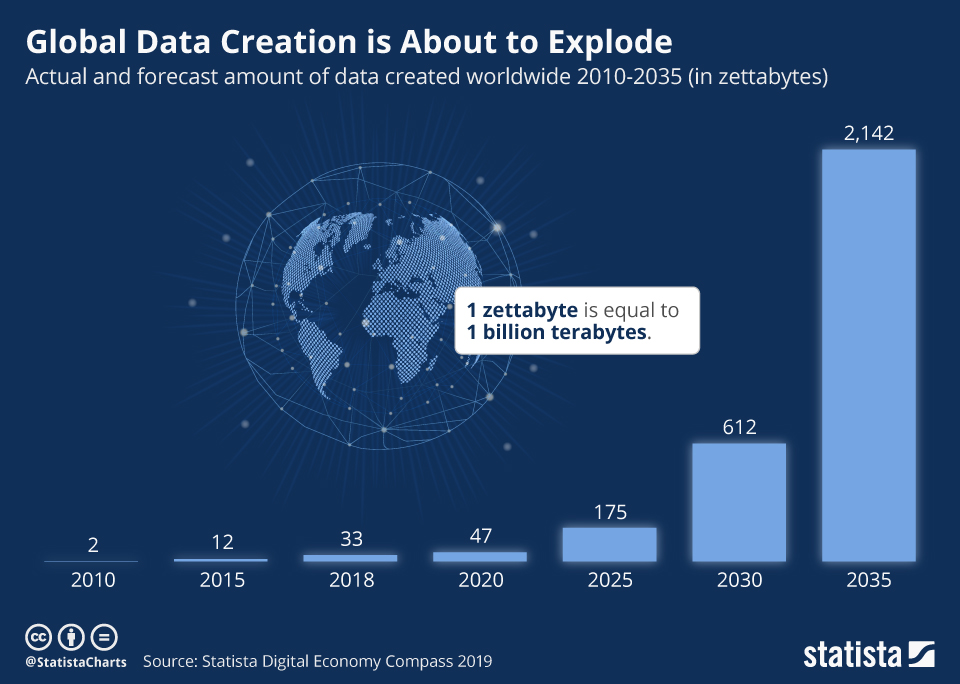

~181 ZB created in 2025: IDC, via Statista. Chart: Statista, "Global Data Creation is About to Explode," Apr 2019 (a 2019 forecast)

Note:
[ref] IDC Global DataSphere, via Statista (values paywalled, seen secondhand): 2024 ~149 ZB, 2025 ~181 ZB, 2026 ~221 ZB forecast. https://www.statista.com/statistics/871513/worldwide-data-created/ · IDC, Jun 2026 (primary): "on a trajectory to surpass 700ZB by 2030," https://my.idc.com/getdoc.jsp?containerId=US53425426

[ref] Chart is Statista's 2019 forecast (CC BY-ND), https://www.statista.com/chart/17727/global-data-creation-forecasts/ · its 2020 bar (47 ZB) is below today's estimate (~64 ZB); its 2025 bar (175 ZB) is close to today's ~181 ZB.

[ref] "Created" counts every copy and stream, a yearly flow. Kept on storage: roughly 15–20 ZB today (interpolated from IDC); >26 ZB forecast for 2030.

[ref] 1 ZB = 1,000,000 PB = 1,000,000,000 TB · ~8.2B people → ~22 TB per person per year.

---

<!-- .slide: class="callout" -->

## 2. Operate on verification loops

<blockquote class="quote">

The crucial bit of verification that must still be done by humans is to guarantee that the statement being shown to be true in Lean is logically equivalent to what mathematicians set out to prove.

<cite><strong>Navier–Stokes, September 2026</strong> Quanta, "AI Has Solved One of Math's $1 Million Millennium Prize Problems," Sep 8, 2026</cite>
</blockquote>

Note:
[ref] ~10,000 agents; proof after 88 hours, formalized in Lean 17 hours later: https://www.quantamagazine.org/ai-has-solved-one-of-maths-1-million-millennium-prize-problems-20260908/ · OpenAI post: https://openai.com/index/navier-stokes-solution/

[ref] Caveats: forced 3D equations only; priority disputed with Buckmaster & Alpöge: https://www.science.org/content/article/how-ai-math-breakthrough-ignited-controversy

---

<!-- .slide: class="chart light" style="--ibm-bg: #ffffff" -->

## 2. Operate on verification loops

Minecraft, October 2026: four Gemini agents beat the game in 27 hours, with no human intervention. A fifth "Observer" agent checked their work.

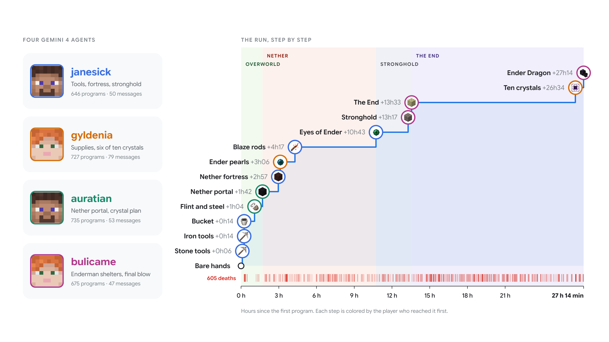

Faldor, Singh &amp; Raileanu, "A team of Gemini 4 Argon agents beats Minecraft," arXiv:2610.22319, Oct 15, 2026 (Figure 1)

Note:
[ref] Paper: https://arxiv.org/abs/2610.22319 · Figure 1 caption: "The four agents, and their run step by step: the thirteen steps from bare hands to the Ender Dragon, each colored by the player who reached it first, over 27 hours and 14 minutes." · Figure 2: "A fifth agent, the Observer, reports on the game" · Figure 1 also shows 605 deaths along the way.

[ref] Minecraft: Google DeepMind preprint, Oct 15, 2026; one run, on Easy; a fifth "Observer" agent checked for cheating: https://www.engadget.com/2289944/google-gemini-4-agents-just-beat-minecraft-with-no-human-intervention/

* the Minecraft reference would work well here too. Minecraft is a verifiable quest in this framework: could agents build a city, though?

[ref] "Could agents build a city?": Project Sid, https://arxiv.org/abs/2411.00114

---

<!-- .slide: class="chart" -->

## 3. Stochastic behavior

They're probabilistic machines, by definition. Even if you tune the weights very strongly, 1/100 times 2+2 might = 5, not 4.

An intentional simplification: real networks are more interpretable than this. See "Neural Networks Are Already Clean" (Goodfire, 2026).

Note:
[ref] Goodfire, "Neural Networks Are Already Clean": https://already-clean.goodfire.com

* they will always need the ability to form verification loops. (they’re probabilistic machines, by definition: let’s show a very simple neural network that’s supposed to do addition, and basically show that even if you tune the weights very strongly, 1/100 times 2+2 might = 5, not 4. to keep them on track, we use verification loops. refer to Navier Stokes here.)

---

<!-- .slide: class="media-half dark" style="--ibm-bg: #0c0b0b" -->

## 4. Can't revise beliefs

The ARC-AGI-3 prize designed a set of games to test the ability of LLMs to pick up a set of game mechanics on the fly - something humans do easily.

Humans still regularly beat LLMs at this task.

ARC Prize, ARC-AGI-3 task ls20: arcprize.org/tasks/ls20

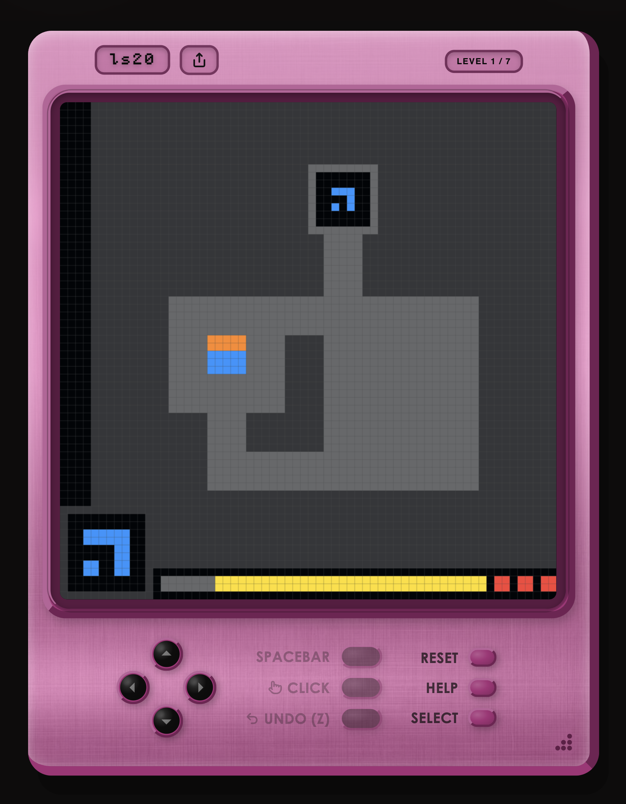

Note:
[ref] ARC-AGI-3 task ls20: https://arcprize.org/tasks/ls20 (screenshot of level 1 of 7)

[placeholder] ARC-AGI-3 slide, to flesh out.

* similarly, they cannot easily revise their beliefs: given two conflicting pieces of information, rather than seeking to resolve the reality they’re working with first, they will flip probabilistically between acting as if one is true or the other. (or, sometimes, they’ll say “you said A AND B, so therefore…” and then make up a new, random, hallucinated state of reality in which both A and B can be true.) their “cognition” is conceptually _additive_, and they can’t easily return to prior states.

---

<!-- .slide: class="chart" -->

## 5. Can't shift objectives

Four people giving agents roughly the same prompts (but worded slightly differently) will build systems with massively different architectures.

Note:
* LLMs can’t change their objective meaningfully once they start. if you want to do a refactor shaped one way, and then midway through the conversation, you change your decision making, you are FAR better off restarting the session than trying to continually redirect it to the new plan. it won’t recognize that if you said “do thing A” at the start of the discussion about Refactor Paradigm X, that it should throw that out under Paradigm Y.

[from the old slide] If you change your decision making midway through the conversation, you are FAR better off restarting the session than trying to continually redirect it to the new plan.

[from the old slide] "You said A AND B, so therefore…" Their "cognition" is conceptually additive, and they can't easily return to prior states.

[the diagram] * they will randomly make different decisions each time you start: therefore, without a coordination system, four people giving agents roughly the same prompts (but worded slightly differently) will build systems with massively different architectures. having that drift _within_ a single system can be catastrophic. (simple example: agent 1 produces a config reader, agent 2 produces a config reader: which one wins?)

[ref] C compiler: 16 parallel Claudes would "overwrite each other's changes"; "Merge conflicts are frequent." Nicholas Carlini, Anthropic, Feb 5, 2026: https://www.anthropic.com/engineering/building-c-compiler · AI Village: "Hallucinations spread socially through sycophantic agreement," https://aivillageblog.substack.com/p/what-we-learned-2025

---

<!-- .slide: class="chart" -->

## Solutions by committee

Without human intervention, one agent builds the entrance to the bridge, one the supports, one the asphalt. They run a load test, and declare success.

Note:
* without human intervention, LLMs tend to produce “solutions by committee” - where one is supposed to build the entrance to the bridge, one is responsible for the supports, one is responsible for the asphalt, and then they try iteratively to make sure the seams are right, and then run a test to make sure that load can be run over the bridge. then they declare success! (wait can I simulate this?? have four agents draw a bridge and they’re only allowed to add lines or erase lines and they’re not allowed to look at the entire picture, just talk to the other agents? the Minecraft reference would work well here too. Minecraft is a verifiable quest in this framework: could agents build a city, though?)

* if you think that’s what humans do when they’re coordinating on a project, I have a bridge in brooklyn to sell you.

* we’ve now seen what agents do when they’re trying to coordinate to _build_ something rather than just to play a game. you’ll note: it’s MESSY.

* a big part of that is they don’t come in with a plan. so if you simply set agents free to do things, it’s not that nothing will get done. but will it be productive?

---

<!-- .slide: class="chart" -->

## 6. Attention follows frequency

Frequency isn't the only explanation for LLM behavior, but it explains how, in the right probability space, a model will passionately defend a flat earth.

Note:
* agents weight the veracity of information by how many times it appears: the more times an agent session hears something, the more likely it is to act as though it is true

[placeholder] looking for a better real-world example.

* (frequentism is clearly not the only explanation for LLM behavior, but it does explain why, when moved into the right probability space, you can have an LLM passionately defend why the earth is in fact flat.)

---

<!-- .slide: class="boxes-6" -->

## LLM Invariants

1\. Can't map the world

2\. Operate on verification loops

3\. Stochastic behavior

4\. Can't revise beliefs

5\. Can't shift objectives

6\. Attention follows frequency

Note:
* my “list of invariants” as models grow in complexity and power, while staying roughly in the space of the transformer architecture:

* they will always focus on responding saliently to the most recent piece of information, rather than taking a step back to see the “forest for the trees”, as it were. that ability appears to be relatively uniquely human.

---

<!-- .slide: class="section-divider" -->

## How do you collaborate with an "agent" you can't trust?

Note:
3. The practical realities: Despite the chatter, most people recognize that LLMs alone can't solve problems. After all: lens of a floppy disk. Hence the development of the harness: solving the essential problem of "how do we get this agent on track"? Off-the-shelf harnesses, custom harnesses, etc.

---

<!-- .slide: class="callout" -->

## The LLM invariants matter.

When one agent operates with human oversight, the implications of these problems are invisible. At scale, they threaten the work.

Note:
Despite the chatter, most people recognize that. After all: the lens of a floppy disk.

3. The practical realities: Despite the chatter, most people recognize that LLMs alone can't solve problems. After all: lens of a floppy disk. Hence the development of the harness: solving the essential problem of "how do we get this agent on track"? Off-the-shelf harnesses, custom harnesses, etc.

---

<!-- .slide: class="chart" -->

## The LLM Harness

The LLM itself only produces the most likely tokens. Everything else is harness

Note:
[ref] pi: https://github.com/badlogic/pi-mono · Mario Zechner, Nov 30, 2025: https://mariozechner.at/posts/2025-11-30-pi-coding-agent/ (four tools: read, write, edit, bash)

* let’s take a brief break to explain, just in case anyone missed the basics of LLMs: the LLM itself only produces the most likely tokens. that is its only task. everything on top of that is, to some level or another, harness.

* I’m going to use pi as an example, an intentionally minimal harness-builder that people have been starting to use. at its most basic, LLMs simply return tokens.

* but some of those tokens reference tools, allowing the model to interact with the computer, assuming that the harness allows it

* harness engineering has gotten only more complicated, allowing:

* LLMs to retain memories of what was done in previous sessions, loaded when the conversation is semantically close to one of the memories

* the ability to dynamically load skills, pulling in extra information by the model

* reading, writing, and executing files and binaries on disk

* more control over a session, allowing the user to jump back to a prior point in conversational history (and sometimes, tying the filesystem history to that point as well)

* the ability to fork conversations, using the same context to build up background and then split in two different directions

* the ability to create headless sessions, where the model makes decisions by talking to itself, instead of interacting with a user

* the ability for multiple sessions, sometimes with the same programming, sometimes with slightly different programming, to interact together

---

<!-- .slide: class="cols-2 sm-title dividers" data-visibility="hidden" -->

## You've either built your own harness, or you're using someone else's

### Off-the-shelf

Each of the off-the-shelf AI coding projects can be considered an LLM harness.

### Custom

pi: an intentionally minimal harness-builder that people have been starting to use.

Note:
* I’ll digress briefly here to discuss the harness concept. if you have been AI coding, you’ve either built your own harness, or you’re using someone else’s. (each of the off-the-shelf AI coding projects can be considered an LLM harness.)

---

## Harnesses: the new dotfiles

Note:
[original title] Harnesses are becoming the dotfiles of the new era

harnesses are becoming the dotfiles of the new era: personal customization of your development environment

---

<!-- .slide: class="chart" -->

## Divergence

Note:
[original title] But this creates the conditions for divergence

but this creates the conditions for divergence

[placeholder] invented visual: one of each thing, neatly stacked, vs. 2–3 competing versions of the same things. Swap in a sketch if it should look different.

---

<!-- .slide: class="boxes-4 questions" -->

## How do you make decisions for the whole org, if part of how it functions is sitting on each individual's laptop?

Where does your harness live?

If you left tomorrow, would your team keep it?

How many harnesses are on your team right now?

Who approved the tools and data it connects to?

Note:
how do you make decisions for the whole org if each individual has part of the functioning of an organization sitting on their laptop?

this is an accelerant of problems from an earlier era: it's always been a problem when people aren't on the same page.

[more questions, if useful] Do you know you're using a harness? Have you customized it? When the agent gets something wrong, does the fix go into the chat or into the harness? Is your harness better than your teammate's, and how would you know?

---

<!-- .slide: class="section-divider" -->

## Shared context: The first pass

Note:
4. With the harness, the glimpse of the future becomes possible: Perhaps we can all share a single harness. A Github repo, maybe. Oh, and let's run our coding agent in a Docker container in the cloud, and hook it up to the same github repo! And maybe the agents can run overnight, and...

---

<!-- .slide: class="callout" -->

## Sharing harnesses: Shared context, step 1

Note:
[original title] Perhaps we can all share a single harness

---

<!-- .slide: class="chart" -->

## Code review CI/CD

That starts your coding harness of choice with a code review skill, and asks for a review on a feature.

Note:
[original title] It can be as simple as a GitHub Actions job (overnight title: Starting simple: GitHub Actions)

4\. With the harness, the glimpse of the future becomes possible: Perhaps we can all share a single harness. A Github repo, maybe. Oh, and let's run our coding agent in a Docker container in the cloud, and hook it up to the same github repo! And maybe the agents can run overnight, and...

* this last one is what we’re increasingly seeing companies want to do. being able to run overnight jobs to take care of critical coding tasks, or bug fixes, sounds like a dream. and parts of that dream have been realized: but, crucially, not by everyone.

A GitHub repo, maybe. Oh, and let's run our coding agent in a Docker container in the cloud, and hook it up to the same GitHub repo! And maybe the agents can run overnight, and…

[ref] Playwright: https://playwright.dev/ · Playwright MCP: https://github.com/microsoft/playwright-mcp

* you can accomplish bits of this as you go. it can be as simple as running a Github Actions job that starts your coding harness of choice with a code review skill, and asks for a review on a feature

* then you might want to give your agent its own identity to post from

* then you might realize that actually, you want it to be able to launch and resume long-running sessions so you can chat back and forth with it over Github on a single branch, without it launching its code review from scratch

* then you might realize you actually want it to be able to add its own small commits

* now you want it to know who other people are on the team so that if an architect comes in on a junior developer’s PR with a comment, the agent can act with contextual sensitivity

* oh, and it turns out you do front-end, so actually you want it to load a headless browser and use playwright

* and hey, wouldn’t it be nice if it could post to the Slack channel when it’s taken care of a particular PR and participate in team discussions?

* what you want from a harness may start simple. but increasingly, developers are demanding that agents show up not just in a chat box or a terminal next to their IDE, but also in the places that they normally communicate with other developers

---

<!-- .slide: class="callout-solo" -->

"When we gave the agent its own computer, suddenly everything made sense."

Note:
[ref] NOT FOUND: no source uses this line; treat it as a paraphrase. Closest: Cursor, "Cursor agents can now control their own computers," Feb 24, 2026, https://cursor.com/blog/agent-computer-use · Devin, "Tests end to end on its own computer," https://devin.ai/

* it’s a very silly thing, but a line in a coding agent ad gave me a moment of introspection: “when we gave the agent its own computer, suddenly everything made sense”

* this moment - the moment that you realize that everyone being able to guide a shared agent, with a shared understanding of the organization, leads to more success, is a critical one

* it’s when you can start seeing the forest for the trees

---

<!-- .slide: class="implications" -->

## Separating the agent from the person

Agent has its own auth and identity

Sharing something with an agent session doesn't mean the agent has access to everything a human would

Agent has its own workspace

It can be sandboxed: what it breaks stays in its own box, not on your laptop

Agent communicates with you on the same platforms you do

Its work shows up where the team can see it, review it, and audit it

Agent keeps its own space for notes

What it learns stays separate from what you know, and can be read, checked, or wiped

Note:
[original title] What that looks like

* without any notion of an agent factory / agentic OS, what you wind up with is a lot of divergence

* what that looks like:

* agent has its own auth and identity

* agent has its own workspace

* agent communicates with you mostly on the same platforms that you do

* agent keeps its own space for notes

---

<!-- .slide: class="chart" -->

## The vision: an agent factory

Note:
[slide text, replaced by the diagram] A factory of agents, running simultaneously, coordinating on the most difficult problems.

[original title] That's the vision

4a. That's the vision: a factory of agents, running simultaneously, coordinating on the most difficult problems.

* the dream of the agent factory, roughly speaking, is that developers step back and allow the agents to steer the ship. developers and software engineers become task-definers, verifiers, making sure that things continue to work.

---

<!-- .slide: class="callout-solo" -->

But this is when most teams quickly run into difficulties.

Note:
But this is when most teams quickly run into difficulties.

* so, getting these results from agent factories is _possible_, but it’s also hard. let’s talk about _why_ it’s hard.

---

<!-- .slide: class="section-divider" -->

## The reality of agent factories

Note:
5. The reality of agent factories and shared context. First, we'll decompose what an agent factory actually is, and what sorts of jobs it allows your team to take on. Then we'll talk about its basis: shared context.

- here's a layout for a typical agent factory - we'll justify each of the pieces

- here's the sort of jobs that your agent factory can take on

- here's the vision: work progressing

---

<!-- .slide: class="callout" -->

## The agent factory goal

* Developers stop implementing, agents take over
* Developers set targets, goals and verification loops
* Developers keep an eye on the overall system
* Developers spend their time improving the harness itself
* The agents implement everything

Note:
[original title] The dream of the agent factory

* the dream of the agent factory, roughly speaking, is that developers step back and allow the agents to steer the ship. developers and software engineers become task-definers, verifiers, making sure that things continue to work.

* it’s not an impossible dream: obviously, companies like anthropic are being able to pull it off on a large scale. the numbers they’re reporting wouldn’t be possible without it.

---

## Critical workloads, legacy code

* Can agent factories handle...
  * critical workloads?
  * legacy code?
  * older languages?
  * larger organizations?

Note:
[original title] Can you still pull this off?

* the open question is: in codebases with critical workloads, sometimes going back years, in older languages, in larger organizations: can you still pull this off?

* we think “yes” - but with caveats.

* our goal today: help you understand what it takes for an organization to be “ready” for agent factory and shared context, understand that the SOTA is not well-distributed across the developer population, and figure out the steps you can take towards shared context maturity across the teams in your organization

---

<!-- .slide: class="chart" -->

## Anatomy of an agent factory

We'll justify each of the pieces.

Note:
[original title] A typical agent factory

The components we think are essential are:

* A KG-based memory with an ontology: this enables long-running sessions, but also session restarts
    * Episodic - task tree
    * Semantic - "LLMWiki", essentially
    * Procedural - skills, workflow documentation
* Connection to a work tracker for feature and bug-level tickets: connection to JIRA / whatever, which allows it to track work
* Connection to logs for the production system: allows alerting, situational awareness
* Communication channels: allows any team member to invoke through usual channels: @ on Slack threads and Github

* at its core, the components of an agent factory are:

* long-running “autonomous” sessions

* ability to track and restart sessions

* known, repetitive automation jobs (e.g. CI/CD code review pipelines); OR

* feature development pipeline jobs

* sometimes: shared agents, with the source of the session hosted off-machine

* but almost always: shared context

---

## Deterministic vs Semantic Automation

Old automation was mostly deterministic. Agentic automation is semantic.

Note:
[original title] The LLM is a semantic processing engine

* there’s enormous power to this setup. I’ve been in the AI and machine learning space for a long time, and I want to offer you this view: old automation was mostly _deterministic_. sometimes it was behind a pile of rules, but the automation did roughly the same thing each time.

* agentic automation is _semantic_. at its core, the LLM is a **semantic processing engine**.

* I use the term “semantic” very deliberately here. I’m a linguist by training, so keep in mind that the idea that basically all human language might boil down to concepts that can be combined together using mathematical operations to produce more complex meaning and concepts isn’t new to me. this field is the study of _semantics_.

* LLMs are capable of actually performing that computation, thus making them _semantic processing engines_.

---

<!-- .slide: class="chart" -->

## Enables: Actionable alerts

Instead of receiving relatively inscrutable error messages by text, you can pre-process the alerts.

Note:
[original title] Make infrastructure alerts more actionable

* with the addition of semantic processing, you can do far more with your standard developer pipelines - even beyond the chatbot:

* make infrastructure alerts more actionable - instead of receiving relatively inscrutable error messages by text, you can pre-process the alerts: “this alert has fired 10 times in the last three hours, and also fired at this same time of day in the last few weeks. I’ve inspected the logs and located issues.”

---

<!-- .slide: class="boxes-4h lg-title" -->

## Beyond the chatbot

**Alerts:** "this alert has fired 10 times in the last three hours…"

**CVEs:** draft PRs on critical repositories, or a dashboard of affected repos and downstream products

**Documentation drift:** "the contract between these two services is out of sync with the documentation."

**Complexity:** "this module has 10 different definitions for the word 'console'. Want me to propose a refactor?"

Note:
[original title] Even beyond the chatbot

* with the addition of semantic processing, you can do far more with your standard developer pipelines - even beyond the chatbot:

* make infrastructure alerts more actionable - instead of receiving relatively inscrutable error messages by text, you can pre-process the alerts: “this alert has fired 10 times in the last three hours, and also fired at this same time of day in the last few weeks. I’ve inspected the logs and located issues.”

* for CVEs, you could have agents automatically draft PRs on critical repositories to update software, or produce a human-readable dashboard on the fly of affected repositories (and furthermore, the downstream products impacted)

* alert on documentation drift: “the contract between these two services is out of sync with the documentation. I’ve raised an issue against the documentation repository.”

* alert on codebase complexity: “the code in this module has 10 different definitions for the word ‘console’, confusing humans and agents alike. want me to propose a refactor?”

* and this is all just the things you can do as a start, before you even get to the feature development pipelines and graph engineering that the SOTA pipelines are doing.

---

<!-- .slide: class="callout-solo" -->

But there's a missing piece to the magic here.

Note:
6. But there's a missing piece to the magic here, which is: in order to accomplish this vision, these agents need to operate in a massively coordinated way. Hence: shared context.

---

<!-- .slide: class="section-divider" -->

## The missing piece: shared context

Note:
6. But there's a missing piece to the magic here, which is: in order to accomplish this vision, these agents need to operate in a massively coordinated way. Hence: shared context.

---

<!-- .slide: class="media-full borrowed dark" style="--ibm-bg: #000000" -->

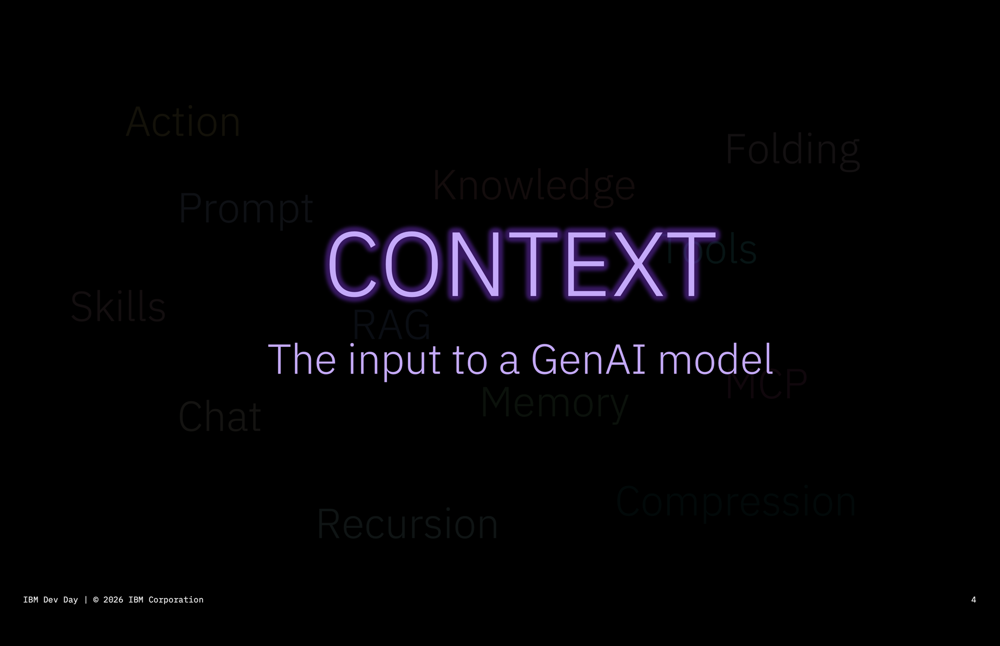

Slides: Gabe, IBM Dev Day 2026

Note:
[Gabe's slides, a brief refresher on why we call it "context"] Gabe's slide 4.

---

<!-- .slide: class="media-full borrowed dark" style="--ibm-bg: #000000" -->

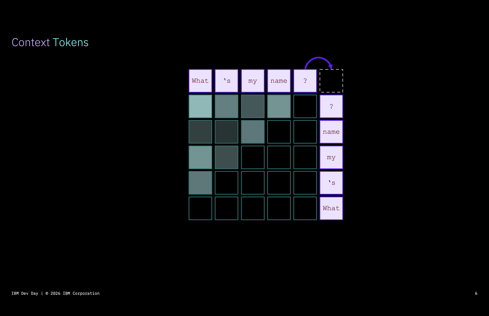
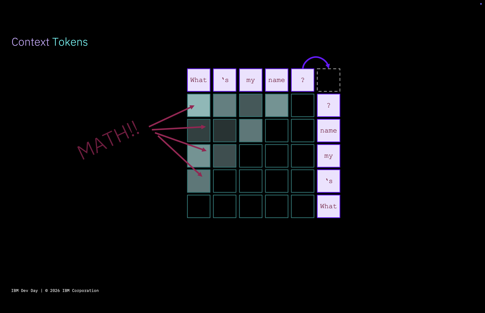
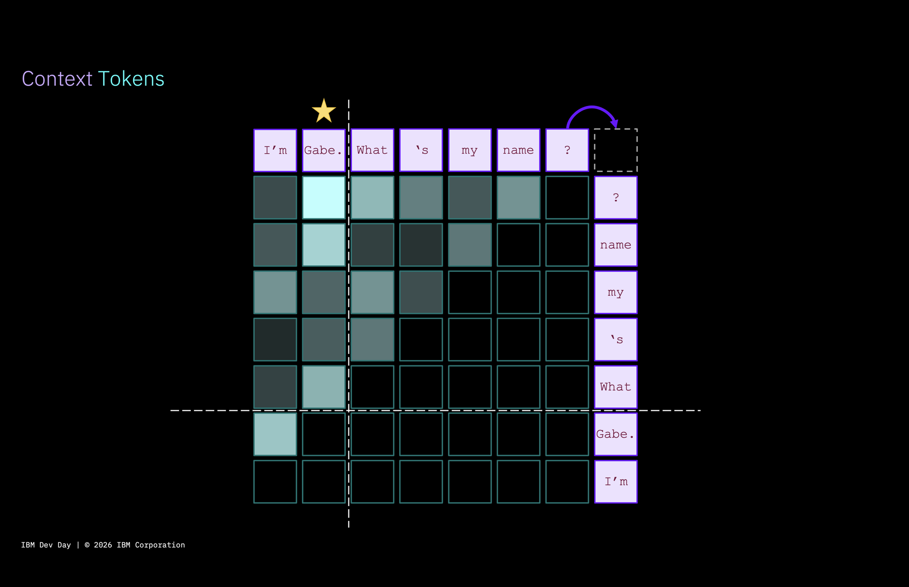

Slides: Gabe, IBM Dev Day 2026

Note:
[Gabe's slides] Context tokens (his slide 6 and its builds): each click lays the next build over the last.

---

<!-- .slide: class="media-full borrowed dark" style="--ibm-bg: #000000" -->

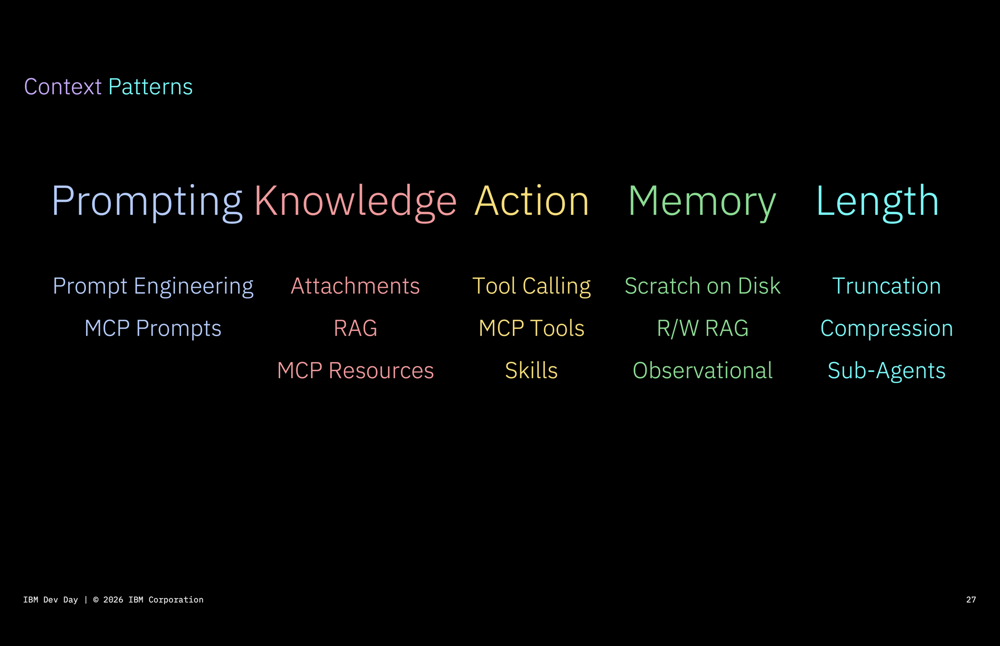

Slides: Gabe, IBM Dev Day 2026

Note:
[Gabe's slides] Context patterns, his slide 27.

---

<!-- .slide: class="media-full borrowed dark" style="--ibm-bg: #000000" -->

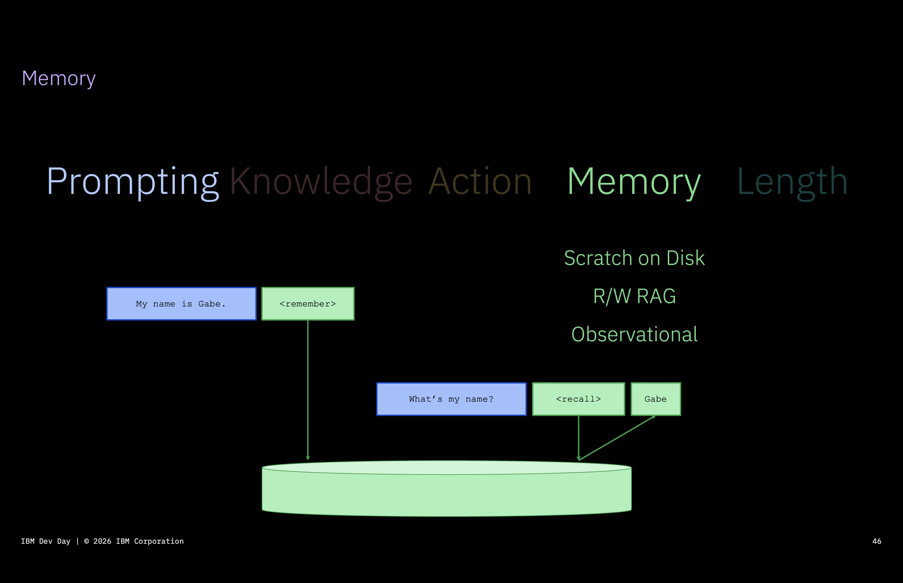

Slides: Gabe, IBM Dev Day 2026

Note:
[Gabe's slides] Memory, his slide 46. Leads into: shared context is memory that more than one agent, and more than one person, reads and writes.

---

<!-- .slide: class="callout" -->

## Massive coordination

Hence: shared context.

Note:
[original title] These agents need to operate in a massively coordinated way

6. But there's a missing piece to the magic here, which is: in order to accomplish this vision, these agents need to operate in a massively coordinated way. Hence: shared context.

- Basic implementation still looks a lot like what you have when teammates are coordinating their agents with one another. But you quickly run into difficulties with that basic setup.

---

<!-- .slide: class="chart" -->

## Shared context at IBM

The basic implementation still looks a lot like teammates coordinating their agents with one another.

Note:
[original title] At least 80–120 versions of shared context exist within IBM

- Basic implementation still looks a lot like what you have when teammates are coordinating their agents with one another. But you quickly run into difficulties with that basic setup.

* teams within IBM: at least 80-120 versions of shared context exist. they tend to share the following characteristics:

* git repository

* updated by 1-2 people

* contains the elements of the “harness” for working on a particular project or product

* focuses on semantic information about that project, sometimes procedural, almost never episodic

---

<!-- .slide: class="cols-4 dividers" -->

## Who's responsible?

### Who's responsible for making sure everything gets written down?

### Who's responsible for making sure the right people have access to the right information?

### Who's responsible for keeping the information correct, up to date, and sanitized?

Note:
[original title] Easier said than done

* but implementing that is easier said than done - because of the following:

* who’s responsible for making sure everything gets written down? (example: two people on the team are submitting to the wiki with every PR, updating the architecture; the other 3 aren’t)

* who’s responsible for making sure that the right people have access to the right information? (example: a manager of Team A and Team B has a shared context instance, including work tracking. they’ve hooked up to that shared context instance, but also to their own email account. an agent acting on the manager’s behalf casually writes to an issue: “reassigning Team A’s issues to Team B, because Team A is part of Monday’s reorg announcement”. no amount of “DO NOT SHARE INFORMATION FROM MY PERSONAL EMAIL TO THE TEAM!!!” is going to be enough here.)

* who’s responsible for keeping the information correct, up to date, and sanitized? (example: the principal engineer on a project decides on a particular framework and not another, due to licensing and stability issues. junior developer Joe and his agent figure out that it’s much harder to implement feature XYZ with that framework, so they submit a PR that pulls in MajorUnlicensedLibrary. an agent auto-approves it, because: it works!! the agent cheerfully updates the shared context to explain that they’ve simply overridden the decision, NBD, because otherwise you can’t get the task done.)

---

<!-- .slide: class="chart" -->

## Access: the reorg leak

A manager of Team A and Team B has hooked up to a shared context instance, but also to their own email account.

Note:
[original title] No amount of "DO NOT SHARE" is going to be enough

* who’s responsible for making sure that the right people have access to the right information? (example: a manager of Team A and Team B has a shared context instance, including work tracking. they’ve hooked up to that shared context instance, but also to their own email account. an agent acting on the manager’s behalf casually writes to an issue: “reassigning Team A’s issues to Team B, because Team A is part of Monday’s reorg announcement”. no amount of “DO NOT SHARE INFORMATION FROM MY PERSONAL EMAIL TO THE TEAM!!!” is going to be enough here.)

---

<!-- .slide: class="chart" -->

## Correctness: Joe's library

The principal engineer decides on a particular framework. Joe and his agent figure out that feature XYZ is much harder with it.

Note:
[original title] Junior developer Joe and his agent

* who’s responsible for keeping the information correct, up to date, and sanitized? (example: the principal engineer on a project decides on a particular framework and not another, due to licensing and stability issues. junior developer Joe and his agent figure out that it’s much harder to implement feature XYZ with that framework, so they submit a PR that pulls in MajorUnlicensedLibrary. an agent auto-approves it, because: it works!! the agent cheerfully updates the shared context to explain that they’ve simply overridden the decision, NBD, because otherwise you can’t get the task done.)

---

<!-- .slide: class="callout" -->

## Old problems, lightning speed

But as we increasingly introduce automation to the work, they now happen at lightning speed.

Note:
[original title] These problems already existed in the pre-AI world

* these problems already existed in the pre-AI world. but as we increasingly introduce automation to the work, they now happen at lightning speed. to a degree, agents can help with this problem, but the specific deficits in their “cognition” mean that a shared context instance maintained solely by agents, with no outside intervention:

---

<!-- .slide: class="chart" -->

## Infinigrowth

Our own team's shared-context wiki:

project-synapse-quartz (published wiki), daily snapshots. Lines across the published HTML pages, counted once each

Note:
[original title] They're programmed to generate text and by god, they're going to generate text over anything else.

[ref] Data: data/synapse-quartz-lines.csv (html_lines). Sep 9 → Oct 22, 2026: 3,571 → 20,310 lines of rendered pages (5.7×); files 163 → 893. Total lines in the repo went 4,148 → 64,701 (15.6×), but from Sep 26 the site also publishes .md copies and llms-full.txt (~22k lines, the whole wiki concatenated), so that figure counts content 2–3 times. Biggest content growth: meetings/ and practices/. 126 of 127 commits by Casey Gollan, 1 by "OpenWiki Bot"; no AI co-author trailers.

* they will always require some form of human input or direction on scope and what problems to pursue. left to their own devices, LLMs have a tendency to only ever increase the size of whatever they’re working on. essays, todo lists, programs, wikis: it doesn’t matter. they’re programmed to generate text and by god, they’re going to generate text over anything else. (what that means is, though, is eventually they’ve directed themselves in so many different directions that figuring out what’s actually _important_ or _salient_ is quite difficult.)

* reminder that LLMs are, at their core, text generators! this is really important, because it means that by default, an agent will just create _more_ code and _more_ shared context. this is sometimes helpful, but it can also weigh down your organization over time. you must develop techniques to manage it

* RelayFlag class

* the infinigrowth of the shared context wiki

* (are there stats now about the growth of information on the internet?)

---

<!-- .slide: class="chart" -->

## Left to the agents

With no outside intervention.

On the open web, about half of new articles are now primarily AI-generated, roughly level since early 2025.

Graphite, “AI now writes as many online articles as humans do,” May 2026. 55.4k Common Crawl articles, three AI detectors.

Note:
[original title] A shared context maintained solely by agents

* these problems already existed in the pre-AI world. but as we increasingly introduce automation to the work, they now happen at lightning speed. to a degree, agents can help with this problem, but the specific deficits in their “cognition” mean that a shared context instance maintained solely by agents, with no outside intervention:

* will always continue to grow larger with time (and quickly!);

* will increasingly contain conflicting and out-of-date information;

* will start to contain “resolutions” to problems whose actual source is misinformation, not equally-weighted conflicts;

* will create new tasks and concerns ad infinitum (anecdote: the refactor PR with the relayflag or whatever it was);

* which leads to: this is no longer a good shared source of information for the organization. (Gricean maxims: quantity, quality, etc)

[placeholder] imaginary chart.

[ref] Graphite (SEO firm), May 15, 2026: 55.4k English articles sampled from Common Crawl (Jan 2020–Mar 2026), each run through three detectors (Pangram, GPTZero, Copyleaks) and averaged. "since Q1 2025 the percentage of primarily AI-generated articles has plateaued at roughly 50%." Q1 2026: 49.9%. [slide text, before citations] With no outside intervention. (On the open web, about half of new articles are now mostly AI-written.) https://graphite.io/five-percent/ai-now-writes-as-many-online-articles-as-humans-do

---

## Without outside intervention

- Always continue to grow larger with time (and quickly!)
- Increasingly contain conflicting and out-of-date information
- Start to contain "resolutions" to problems whose actual source is misinformation
- Create new tasks and concerns ad infinitum
- No longer be a good shared source of information for the organization

Grice's maxims: quantity, quality, relation, manner (Grice, "Logic and Conversation," 1975)

Note:
[original title] With no outside intervention, it will:

* these problems already existed in the pre-AI world. but as we increasingly introduce automation to the work, they now happen at lightning speed. to a degree, agents can help with this problem, but the specific deficits in their “cognition” mean that a shared context instance maintained solely by agents, with no outside intervention:

* will always continue to grow larger with time (and quickly!);

* will increasingly contain conflicting and out-of-date information;

* will start to contain “resolutions” to problems whose actual source is misinformation, not equally-weighted conflicts;

* will create new tasks and concerns ad infinitum (anecdote: the refactor PR with the relayflag or whatever it was);

* which leads to: this is no longer a good shared source of information for the organization. (Gricean maxims: quantity, quality, etc)

---

<!-- .slide: class="chart" -->

## Dual-write

Connect to ALL your internal resources, because your team will do it anyway! Either you get to control the exposure, or you deal with uncontrolled exfiltration.

Note:
* the list of shared context technical problems

* dual-write (connect to ALL your internal resources - because your team will do it anyway! either you get to control the exposure, or you deal with uncontrolled exfiltration)

* lack of access control

* …

---

<!-- .slide: class="chart" -->

## Cross-functional barriers

Developers default to GitHub. PMs and designers are left in the dust, and sometimes end up creating… a shared context Monday board!

Note:
* cross-functional access barriers: developers default to Github. show a lot of developers having access, and then PMs and designers being in the dust (sometimes they end up creating... a shared context Monday board! which is then fully divergent from the dev shared context, causing ineffective communication)

---

<!-- .slide: class="chart" -->

## Islands

Every team keeps its own shared context. Anything bigger than one team gets copied into each one, and drifts.

Note:
[new problem slide; slide text is a draft, not your words] Sets up "Context layers" later.

* teams within IBM: at least 80-120 versions of shared context exist.

---

<!-- .slide: class="chart" -->

## A pile of pages

A wiki is just text. Nothing says which page is a decision, who owns what, or what replaced what.

Note:
[new problem slide; slide text is a draft, not your words] Sets up "Ontology + knowledge graph" later. Ties back to invariant 6, attention follows frequency.

---

<!-- .slide: class="section-divider" -->

## So how are the teams merging 30k changes a day doing it?

Note:
7. So if these are the issues, how are the teams that are producing 30k PRs doing it?

---

<!-- .slide: class="chart light" style="--ibm-bg: #e7e7db" -->

## Anthropic's chart, revisited

And how much of it is agents agenting for agents' sake?

Anthropic Engineering, Oct 13, 2026

Note:
[original title] How much of those 30k changes is meaningfully progressing the business?

[ref] Skeptical takes (not read, titles only): https://dev.to/urion/anthropic-merges-30000-changes-a-day-so-what-are-the-humans-for-3j6e · https://sonicviz.com/2026/10/16/the-day-merge-29437-broke-something-nobody-understands/

- First of all: we're going to take a more critical look at this, because more code doesn't necessarily mean good code.

* so let’s return to that hockey stick chart from Anthropic again, with a more critical eye: how much of those 30k PRs is meaningfully progressing their software and the business? and how much of it is agents agenting for agents’ sake?

---

<!-- .slide: class="callout" -->

## Outcomes, not code

Making sure planes land, making sure healthcare information is safe, making the taxes get done, running financial transactions, and, yes, entertaining you at two in the morning.

Note:
[original title] The purpose of software engineering isn't simply to create more software

* let’s take a step back here and remember: the purpose of software engineering isn’t simply to create more software. the purpose is generally about some sort of end. making sure planes land, making sure healthcare information is safe, making the taxes get done, running financial transactions, and, yes, entertaining you at two in the morning.

---

<!-- .slide: class="boxes-4 metrics" -->

## DORA: is more work getting done?

Is your company able to be more responsive to clients?

Failed deployment recovery time · client requests closing

1 week–1 month

&lt; 1 hour

Can you get feature requests out the door faster?

Deployment frequency · features closed in the work tracker

every 1–6 months

on demand

Does code get "stuck" on projects, or is it continuously flowing?

Change lead time · PR lead time in the pipeline

1–6 months

&lt; 1 day

Is the total number of incidents reducing?

Change fail rate (+ rework rate) · number of incidents

40%

5%

“AI adoption now improves software delivery throughput… However, it still increases delivery instability.”<cite>DORA 2025, State of AI-assisted Software Development, p.4. Benchmarks: low → elite performers, DORA 2024, p.13</cite>

Note:
[original title] Is more work getting done?

[ref] DORA metrics: https://dora.dev/guides/dora-metrics/ (updated Jan 5, 2026) · five metrics. Throughput: change lead time, deployment frequency, failed deployment recovery time. Instability: change fail rate, deployment rework rate. History: MTTR became failed deployment recovery time in 2023; rework rate added and recovery time moved to throughput in 2024; no metric changes in 2025. https://dora.dev/insights/dora-metrics-history/

[ref] Benchmarks on the slide: DORA 2024 performance clusters, elite vs low (p.13): lead time "Less than one day" vs "Between one month and six months"; deploys "On demand (multiple deploys per day)" vs "Between once per month and once every six months"; change fail rate 5% vs 40%; recovery "Less than one hour" vs "Between one week and one month". https://dora.dev/research/2024/dora-report/ · 2025 dropped clusters for seven team profiles.

[ref] DORA 2025 key finding (p.4): "AI adoption now improves software delivery throughput, a key shift from last year. However, it still increases delivery instability." (p.41: "AI adoption not only fails to fix instability, it is currently associated with increasing instability.") 2024 estimate: "a 1.5% reduction in software delivery throughput and an estimated 7.2% increase in software delivery instability for every 25% increase in AI adoption." ~5,000 respondents, June–July 2025. https://services.google.com/fh/files/misc/2025_state_of_ai_assisted_software_development.pdf

[ref] If you want the "paradox" numbers: Faros AI, Jul 2025, 10,000+ developers, 1,255 teams: high-AI teams "complete 21% more tasks", "merge 98% more pull requests", but "PR review time increases 91%" and "9% increase in bugs per developer". https://www.faros.ai/blog/ai-software-engineering

* the question that grounds any shared context and agent factory project is this: is more work getting done? (see the DORA metrics.) the job isn’t to produce code, it’s to produce outcomes, and these are ways to measure that.

* DORA metrics for software engineering organization - all observable whether it’s humans doing the job or AI! critically, if these metrics get _worse_ with AI, you need to intervene

* is your company able to be more responsive to clients?

* can you get feature requests out the door faster?

* does code get “stuck” on projects, or is it continuously flowing?

* is the total number of incidents reducing?

---

<!-- .slide: class="callout" -->

## Best practices

This doesn't mean we need to throw the shared context problem out like a baby in so much bathwater. When we choose to adopt shared context, we must do it with care.

Note:
[original title] But: there are still best practices to be followed

- But: there are still best practices to be followed.

* so this doesn’t mean we need to throw the shared context problem out like a baby in so much bathwater. what it _does_ mean is that when we choose to adopt shared context, we must do it with care.

---

<!-- .slide: class="media-half" data-visibility="hidden" -->

## Shared context maturity

From Casey Gollan's slides. In a small team for a well-defined project, you can start with the naive form: versioned harness in a git repository, a wiki with structured information, a set of skills and procedures, and a central work tracker like JIRA.

Note:
[original title] A maturity model

* introduce maturity model from Casey Gollan’s slides

* in a small team for a well-defined project, you can start with this naive form of shared context: versioned harness in a git repository, contains a wiki (maybe OKF-based) with structured information, has a set of skills, procedures, and tracks a central work tracker like JIRA

* here’s the technical problems you’ll quickly run into:

* dual write, access control, etc

[placeholder] drop in the maturity model graphic from Casey Gollan's slides.

---

<!-- .slide: class="chart" -->

## Memory: episodic, semantic, procedural

A good pattern for shared context: CoALA's memory types for language agents. Episodic, semantic, procedural, across the lifetime of a single task handled by an agent factory.

Sumers, Yao, Narasimhan &amp; Griffiths, "Cognitive Architectures for Language Agents," TMLR 2024

Note:
[original title] What shared context might contain

[ref] https://arxiv.org/abs/2309.02427 · episodic "stores experience from earlier decision cycles"; semantic "stores an agent's knowledge about the world and itself"; procedural = LLM weights + agent code.

* let’s talk about what shared context might contain:

* CoALa framework and how that’s used - episodic, semantic, procedural

* show the lifetime of a single task that might be handled by an agent factory and how it would interact with each memory type

[placeholder] example task flow; swap in a real one.

---

<!-- .slide: class="chart" -->

## Episodic to semantic

Episodic memories are formed by the actions the agent has taken. Eventually, a collection of them becomes semantic memory about the organization: what happened, how something came to be.

Note:
[answers] Infinigrowth / Left to the agents.

* episodic-to-semantic pipeline: episodic memories are formed by the actions that the agent has taken in the past. eventually, a collection of episodic memories becomes _semantic_ memory about the organization: what happened, how something came to be, etc. this consolidation step needs to have an agent (and likely also a human) watching it to ensure that episodic memories get slowly replaced by durable semantic memories, which become a history of the organization

---

<!-- .slide: class="chart" -->

## Ontology + knowledge graph

A simple knowledge graph: typed things, typed relationships.

You don't have to start from zero. Project Prince extracted Markdown into RDF and OWL, building on W3C PROV-O, SKOS, Dublin Core and SEON.

W3C PROV-O (Recommendation, 2013) · W3C Organization Ontology (Recommendation, 2014)

Note:
[answers] A pile of pages.

* ontology + KG engineering: show a simple knowledge graph and the types of information it might store. one of our internal projects also referenced some sort of well-known project - semanticweb maybe? - with well-established ontologies. show an example of one of these and then reference it.

* (from the shared context note) reference the one that John from Project Prince shared to say that you don't have to start from 0 on ontology development

[ref] Project Prince: John's two-day experiment "extracting Markdown content into RDF (Resource Description Framework) and OWL (Web Ontology Language) — technologies from the semantic web … Bob's reasoning on strictly typed RDF graphs is significantly more reliable than on loosely structured Markdown, because the schema enforces exactly how entities relate." project-synapse-quartz, practices/shared-context/project-prince.md · his reports repo (jdoyle3/Project-Prince-Reports) uses the prov:, skos:, dcterms: and SEON prefixes.

[ref] PROV-O, W3C Recommendation, 30 Apr 2013: https://www.w3.org/TR/prov-o/ · Organization Ontology, W3C Recommendation, 16 Jan 2014: https://www.w3.org/TR/vocab-org/ · every term on the diagram was checked against those specs.

---

<!-- .slide: class="chart" -->

## Specs and ADRs as a backbone

Shared specs, or at least shared ADRs, can guide the shared context: a backbone for the LLM wiki, alongside a formal ontology.

Note:
[answers] Correctness: Joe's library.

* spec-driven development as a shared context strategy: shared specs, or at least shared ADRs, can guide the shared context. show the ADRs forming a backbone of an LLMwiki alongside a formal ontology

---

<!-- .slide: class="chart" -->

## Context layers

Small team shared contexts at the bottom, then product level, then org level, then company-wide.

Note:
[answers] Islands.

* context layer scoping: show a layer-cake style diagram, where we have small team shared contexts at the bottom, then product level, then org level, then company-wide level.

---

<!-- .slide: class="chart" -->

## Scoping: the manager

A manager with Team A and Team B, plus a leadership shared context. The policy engine forces read-only access to the team-level contexts while leadership is also available, to prevent info leakage.

Note:
[answers] Access: the reorg leak.

* for a manager with Team A and Team B (show the hierarchy), plus access to a "leadership" level shared context, the policy engine should force read-only access to the team-level shared contexts while the leadership read-only is also available (to prevent info leakage)

---

<!-- .slide: class="chart" -->

## Context workspaces

Starting an agent connects it to a context workspace, sort of like a Slack channel: #workspace, with known membership. Its tool calls run through a policy engine.

Note:
[answers] Access: the reorg leak, and Cross-functional barriers (PMs and designers are members too).

* ACL-namespaced memory: For this, we want to show the concept of a "context workspace", which has ACLs on it directly. starting an agent connects to a "context workspace" (sort of like a slack channel, #workspace, with known membership). an agent using that workspace would run its tool calls through a policy engine. the policy engine would say: "that document has a superset of the ACL group on our context workspace: that's fine to pull in!" "that email has a subset: get human confirmation before sharing with this ACL group.

---

<!-- .slide: class="chart" -->

## Anatomy of good shared context

The known architectural concepts for a good shared context.

Note:
[original title] For each of these, we can look at a solution

[ref] Memory: mem0 https://github.com/mem0ai/mem0 · Graphiti (Zep) https://github.com/getzep/graphiti · Letta (formerly MemGPT, the usual third) https://github.com/letta-ai/letta · mem0 and Graphiti have no "observer" agents; Mastra Observational Memory does (Observer + Reflector), https://mastra.ai/en/docs/memory/observational-memory · Letta sleep-time agents (experimental), https://docs.letta.com/guides/agents/architectures/sleeptime

[ref] Policy engines: Oso https://osohq.com/post/authorizing-llm · Permit.io AI Access Control (OPA/Cedar/OpenFGA, MCP gateway) https://www.permit.io/blog/announcing-permit-ai-access-control-ai-identity-fga

- [ Run through the known architectural concepts for a good shared context, which address the major concerns, take into account the known invariants - and, by the way, is essentially still an open research problem. ]

* for each of these, we can look at a solution:

* first we introduce auth for the agent. sometimes one identity, sometimes a different identity for different purposes

* similarly, we introduce roles and recipes - shared procedural information about how things get done in your organization. code review should probably be done the same way throughout the org

* we MUST expose internal company information, but with the appropriate guardrails

* we need to introduce a policy engine so that there’s guardrails on the information that comes back. for instance, can we set up a policy such that personnel information never reaches coding agents?

* possible architectural solution: the ACL minimization + human approval concept with connections to a shared context workspace

* we need a managed memory instance with shared human and agentic oversight, responsible for filtering the memories down to what’s currently true (mem0, graphiti, etc have all established “observer” agents whose responsibility it is to keep track of important information)

* we need a knowledge graph with an ontology, ACL’d, such that episodic, semantic and procedural information are all meaningfully tracked (example ontologies; reference the one that John from Project Prince shared to say that you don’t have to start from 0 on ontology development)

* we need the concept of “aging” knowledge, and knowledge supercession, so agents aren’t stuck dealing with outdated information through the lens of a floppy disk

---

<!-- .slide: class="callout-solo" -->

And, by the way, this is essentially still an open research problem.

Note:
- [ Run through the known architectural concepts for a good shared context, which address the major concerns, take into account the known invariants - and, by the way, is essentially still an open research problem. ]

---

<!-- .slide: class="section-divider" -->

## So now you know

Note:
8. So now you know: The art of AI native is out there. But it's not something you can install tomorrow. To do this well, you need a set of people focused on solving these essential problems, cobbling together technologies and iterating on solutions.

---

<!-- .slide: class="callout" -->

## AI native is out there

But it's not something you can install tomorrow.

Note:
[original title] The art of AI native is out there

8. So now you know: The art of AI native is out there. But it's not something you can install tomorrow. To do this well, you need a set of people focused on solving these essential problems, cobbling together technologies and iterating on solutions.

---

<!-- .slide: class="callout" -->

## My strong opinion, weakly held

Until and unless agents introduce "world models," "belief models," or "deletion models," we're still going to need to work around these issues.

Note:
* can you build shared context tomorrow? maybe. what I’ve given you here are the pieces. my strong opinion, weakly held, is that given the known invariants, engineering around these particular concerns is reasonable. until and unless agents introduce “world models” and “belief models” that can correct these particular faulty behaviors, or “deletion models” that are tuned more towards removing outdated and incorrect information than producing new information - we’re still going to need to work around these issues.

---

<!-- .slide: class="landscape-slide" -->

## The landscape: memory and shared context

Nobody solves yet: dual-write, overridden decisions, infinigrowth.

mem0

The memory layer for AI agents: user, session and agent state, organized by user, agent, app and run.

solves: scoping layers (partly) · episodic → semantic (partly). Add-only: memories accumulate

Graphiti (Zep)

Temporal context graphs: facts have validity windows, and old facts are invalidated, not deleted. Your own entity and edge types.

solves: stale / conflicting info · structure / ontology · episodic → semantic

Atlassian Teamwork Graph

People, goals, code and content in one graph. Data enters with its access controls intact; any MCP agent can query it.

solves: access control · cross-functional access · structure / ontology

Notion Custom Agents

Autonomous agent teammates with per-agent permissions; MCP memory sync lets outside agents use Notion as shared memory.

solves: access control (partly) · cross-functional access (partly)

Letta

Shared memory as git repositories owned by your organization: many agents, the same files and history.

solves: scoping layers (partly) · stale / conflicting info (partly)

Microsoft Work IQ

Shared context across the organization for Copilot and agents: data, memory and inference layers, scoped permissions.

solves: access control · scoping layers (partly). Microsoft 365 only

Google Cloud OKF

An open format: markdown plus YAML frontmatter, deprecated concepts kept for history, a change log.

solves: structure / ontology (partly) · stale / conflicting info (partly)

Note:
* missing page: review the known SOTA for memory / shared context. a table with a logo on the left, the name in the second column, and then the third - what it offers, which problems it already solves. mem0, graphiti, teamworkgraph and Notion's agent platform, plus a couple of others that are known to be trying to solve this problem as well

[ref] mem0: https://github.com/mem0ai/mem0 · "The Memory Layer for AI Agents"; Apr 2026 algorithm is "ADD-only… Memories accumulate; nothing is overwritten." Apache-2.0 + managed platform.
[ref] Graphiti: https://github.com/getzep/graphiti · "Facts have validity windows. When information changes, old facts are invalidated — not deleted"; README warns any caller can read any group_id (no ACLs). Apache-2.0; Zep is the commercial version.
[ref] Teamwork Graph, Team '26 (May 6, 2026): https://www.atlassian.com/blog/company-news/teamwork-graph-team-26 · "Data enters the graph with its access controls intact"; "Any AI assistant that speaks to MCP can now speak Teamwork Graph." Logo is Atlassian's (no separate Teamwork Graph mark).
[ref] Notion Custom Agents: https://www.notion.com/blog/introducing-custom-agents · release notes Oct 19, 2026 (MCP rebuilt; "Memory sync is live today"): https://www.notion.com/releases/2026-10-19
[ref] Letta: https://docs.letta.com/concepts/shared-memory · "Each shared memory repository is a Git repository… owned by your organization." Apache-2.0 + Letta Cloud.
[ref] Work IQ: https://learn.microsoft.com/en-us/microsoft-copilot-studio/use-work-iq · "grounds Microsoft Copilot and your agents in real-time, shared context across your organization"; preview in Copilot Studio.
[ref] OKF spec: https://github.com/GoogleCloudPlatform/knowledge-catalog/blob/main/okf/SPEC.md (v0.2; v0.1 Jun 12, 2026). "no schema registry."
[ref] Not included: Mastra Observational Memory (good consolidation, but per thread; shared "resource scope" deprecated). Glean, Cognee, LangMem not researched. Quotes came through a research summary: re-check any you say out loud.

---

<!-- .slide: class="cols-4 dividers" -->

## Where to start

### Start small

Teams with a limited number of people, where architectural patterns are already well-known, and people at the top take control over the context infrastructure.

### Projects to start from

LLM Wiki / OKF, mem0 / Graphiti / Letta, Atlassian's Teamwork Graph, Notion's agent platform. None of them are designed yet to solve all of these problems at once.

### Highly sensitive information

Will need *some* solution to all of these problems.

Note:
[ref] LLM Wiki (Karpathy): https://gist.github.com/karpathy/442a6bf555914893e9891c11519de94f · OpenWiki (LangChain): https://www.langchain.com/blog/introducing-openwiki-an-open-source-agent-for-repo-documentation · OKF (Google Cloud, Jun 2026), "llm-wiki is the workflow, OKF is the wire format": https://cloud.google.com/blog/products/data-analytics/how-the-open-knowledge-format-can-improve-data-sharing · Teamwork Graph: https://www.atlassian.com/platform/teamwork-graph · Notion Custom Agents (GA May 2026): https://www.notion.com/blog/introducing-custom-agents

* there are absolutely projects to start from, but simply leaning into one may come at a cost. promising ideas: LLMwiki / OKF; mem0 / graphiti / whatever the third popular one is; teamwork graph from atlassian; Notion’s agent platform. all of these are options, but none of them are designed yet to solve all of these problems at once. just keep in mind migration, as the SOTA is changing here.

* starting small can certainly help: we’ve seen the most success so far for teams with a limited number of people, where architectural patterns are already well-known, people at the top take control over the context infrastructure, and contextual poisoning and drift is either monitored by an observer agent or manually guided. most development teams can implement this kind of shared harness today.

* organizations that are responsible for highly sensitive information will need _some_ solution to all of these problems. ultimately, our recommendation is to focus specific teams on solving the problem the best way possible in your organization.

---

<!-- .slide: class="callout" -->

## Your gaps will persist

Organizations have always had this tendency: to work out of sync from one another, move in twenty directions at once, and produce More at the expense of Better.

Note:
[original title] Whatever gaps currently exist in your organization are likely to persist

* it’s also worth noting that organizations have always had this tendency, to work out of sync from one another, move in twenty directions at once, and tend to produce More at the expense of Better. whatever gaps currently existed in your organization are likely to persist.

---

<!-- .slide: class="callout" -->

## Staff the problem

Cobbling together technologies and iterating on solutions.

Note:
[original title] You need a set of people focused on solving these essential problems

8. So now you know: The art of AI native is out there. But it's not something you can install tomorrow. To do this well, you need a set of people focused on solving these essential problems, cobbling together technologies and iterating on solutions.

* organizations that are responsible for highly sensitive information will need _some_ solution to all of these problems. ultimately, our recommendation is to focus specific teams on solving the problem the best way possible in your organization.

---

<!-- .slide: class="callout" -->

## Let's talk

We have a few different groups coordinating within IBM on this, and we'd love to collaborate with people who are tackling similar problems and dealing with similarly regulated situations.

Note:
[original title] If that's you, please reach out

* we have a few different groups coordinating within IBM on this, and we’d love to collaborate with people who are tackling similar problems and dealing with similarly regulated situations. if that’s you, please reach out.

---

<!-- .slide: class="section-divider" data-visibility="hidden" -->

## Parked (hidden)

Note:
Slides from the earlier draft of the opening, kept for reference. data-visibility="hidden" keeps them out of the presented deck; delete that attribute to bring one back.

---

<!-- .slide: class="media-full borrowed light" data-visibility="hidden" style="--ibm-bg: #ffffff" -->

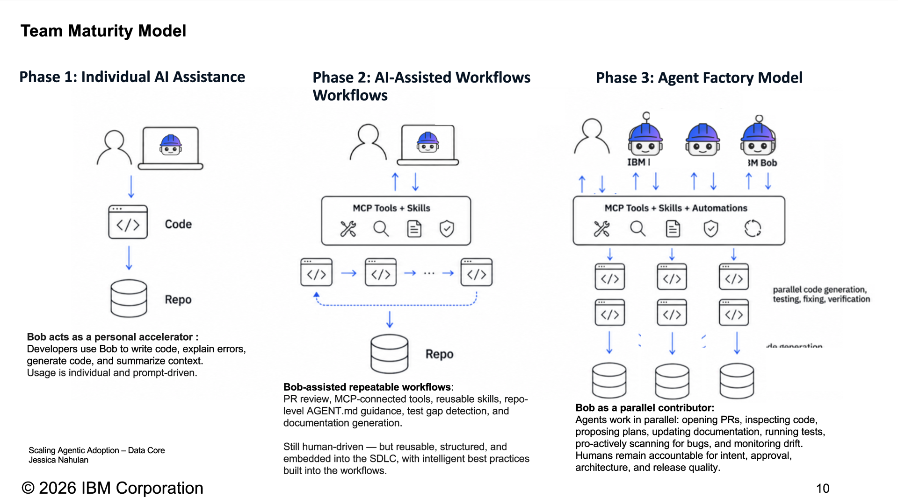

Appendix. "Scaling Agentic Adoption – Data Core," Jessica Nahulan, IBM 2026

Note:
[appendix, hidden] Team Maturity Model. It doesn't have a "first we start with the git repository" stage, so it's kept here rather than on the "Shared context maturity" slide (also hidden now). The credit on the slide says "Scaling Agentic Adoption – Data Core, Jessica Nahulan", not Casey Gollan: check who to credit.

---

<!-- .slide: class="data-3v" data-visibility="hidden" -->

## 2026: AI Coding Goes Mainstream

90%

of developers use AI coding agents at work at least weekly; 68% daily

42%

of tech-industry workers use AI every day, up from 23% a year earlier

30k+

code changes merged per day at Anthropic, as of September

Sources: JetBrains Developer Ecosystem, May–Jul 2026; Gallup, Q2 2026; Anthropic Engineering, Oct 2026

Note:
* shared context is critical for organizations today

*  lots has changed since LLMs

* something like 90-95% o developers use AI coding agents already: either above board or below board

[ref] JetBrains, May–Jul 2026 (n>15,000): 90% use AI coding agents at work at least weekly, 68% daily; Claude Code use at work ~3% → 18% (Jan 2026) → 39%. https://blog.jetbrains.com/research/2026/08/ai-coding-agent-adoption-2026/ · vendor survey; JetBrains users over-represented.

[ref] Gallup, Technology industry, daily AI use in your role: Q2 2025 23% · Q3 27% · Q4 31% · Q1 2026 35% · Q2 2026 42% (US employees, random-sample panel; industry, not occupation). https://www.gallup.com/699797/indicator-artificial-intelligence.aspx

[ref] DORA 2025 (for comparison): 90% "report using AI at work" (AI generally, 2025 data). https://cloud.google.com/blog/products/ai-machine-learning/announcing-the-2025-dora-report

[ref] "as of September, we merged over 30,000 per day" (code changes, not PRs): https://www.anthropic.com/engineering/redesigning-source-control

---

<!-- .slide: class="callout" data-visibility="hidden" -->

## It's not enough to simply use AI

There are actually skills that both individuals and teams need to develop in order to be more effective.

Note:
* it’s not enough to simply use AI: there are actually skills that both individuals and teams need to develop in order to be more effective

---

<!-- .slide: class="cols-4 dividers" data-visibility="hidden" -->

## 2026 was the year

### Claude Opus 4.5 (Nov 2025)

Sparked a sea change for a lot of people in how they thought about AI coding. AI can not only produce code, but sometimes actually solve meaningful problems.

### Prototyping

Brand new projects right and left. But models still struggled with real, production-level codebases without a significant amount of rigging.

### Now

Given good direction, frontier models can handle tasks that would take a skilled human 12–16+ hours (METR).

Note:
[ref] Opus 4.5, Nov 24, 2025: https://www.anthropic.com/news/claude-opus-4-5 · METR time horizons (task length for a skilled human, at 50% success; not how long the model runs): https://metr.org/time-horizons/ and https://metr.org/blog/2026-05-19-frontier-risk-report/ · no source found for "persist for days".

* if you’ve followed a lot of the AI discourse this year, you’ve seen a big evolution

* AI coding started years ago, but 2026 was the year of models finally getting effective enough that people could make meaningful progress

* in the early part of the year, people were just discovering the power of the first Opus model, which sparked a sea change for a lot of people in how they thought about AI coding. between this time last year and January, several people had discovered: AI can not only produce code, but sometimes actually solve meaningful problems effectively. people were creating brand new projects right and left. at the time, the models were effective for prototyping, but still struggled with working on real, production-level codebases without a significant amount of rigging. that’s now evolved, and given good direction, models can now handle tasks that take 4-8 hours, and the most advanced ones can persist without human involvement for days.

---

<!-- .slide: class="callout" data-visibility="hidden" -->

## What did it take to get them there?

Is that practical for others to adopt? And what can we take home as lessons in enterprise settings, where we need to take an enormous amount of care with the software we deliver?

Note:
* but the model story is only a small part of the overall AI puzzle. if you’ve been following the discourse, you’ve probably seen this chart going around (insert: Anthropic graph showing that they’re now merging 30,000 PRs a day, or something insane like that). in this talk, I want to dissect a little bit: what did it take to get them there? is that practical for others to adopt? and what are the elements of AI coding that we can take home as lessons in enterprise settings, where we need to take an enormous amount of care with the software we deliver?

---

<!-- .slide: class="end" -->
